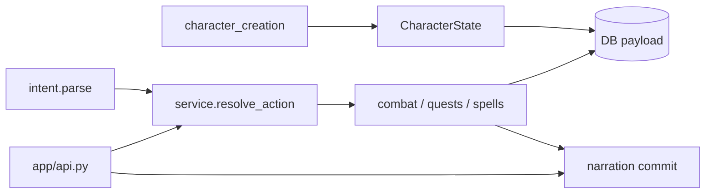

# Engine dependency map V1 (Sprint 28)

When a **shared module** changes, run the listed regression tests (not only tests colocated with the file).

## Flow chains

| Chain | Modules | Must-run pytest |
|-------|---------|-----------------|
| Character creation → play | `character_creation.py`, `service.create_character`, `equipment.py`, `api.py` `/characters` | `test_character_creation_v2`, `test_character_creation_mvp_matrix`, `test_integration` (create flow), `test_sprint26_racial_traits` |
| Intent → resolution | `intent.py`, `service.py`, `combat_action_economy.py` | `test_intent`, `test_intent_negation`, `test_sprint25_combat_action_economy`, `test_gameplay_integrity` |
| Combat positioning & range | `combat_positioning.py`, `combat_range.py`, `combat_move.py`, enemy AI in `service.py` | `test_sprint27_ranged_combat`, `test_sprint27_1_combat_integration`, `test_sprint28_gameplay_journey_smoke`, `test_sprint15_story_progression` (slow) |
| Combat reactions & OA | `combat_reactions.py`, `combat_action_economy.py`, movement hooks in `service.py` | `test_sprint29_combat_reactions`, `test_sprint30_combat_reactions_hardening`, `test_sprint25_combat_action_economy`, `test_sprint27_*`, Playwright `combat-reactions.spec.ts` |
| Quests → XP → chapter | `quests.py`, `chapter_one_progression.py`, `economy_balance.py` | `test_sprint15_story_progression`, `test_sprint22_chapter_one_completion`, `test_chapter_one_journey` |
| Saves & conditions | `saving_throws.py`, combat effect helpers | `test_saving_throws_v1`, `test_sprint19_unified_combat` |
| Spellcasting | `spells.py`, `spell_saves.py`, `_cast_spell` in `service.py`, `combat_action_economy.spell_combat_cost` | `test_spells`, `test_sprint31_spellcasting_integrity`, `test_sprint25_combat_action_economy` |
| Skills | `skill_challenges.py` | `test_sprint23_skill_challenges` |
| Backgrounds / race | `background_features.py`, `race_features.py` | `test_sprint24_background_features`, `test_sprint26_racial_traits` |
| Persistence & concurrency | `app/db/*`, Alembic | `test_integration`, `test_concurrency`, `test_alembic_v005` (Postgres job) |
| API auth / idempotency | `api.py`, rate limits | `test_auth`, `test_api_systems`, `test_telegram_auth` |

## Module → quick selector

| If you touch | Run |
|--------------|-----|
| `app/engine/service.py` | `.\scripts\run_tests.ps1 regress` + `test_gameplay_integrity` |
| `app/engine/intent.py` | `test_intent*`, `test_sprint25*`, `test_sprint27*` |
| `app/engine/combat_*.py` | `test_sprint27*`, `test_sprint28_gameplay_journey_smoke`, slow `test_sprint15` |
| `app/engine/quests.py` or `chapter_one_progression.py` | `test_sprint15*`, `test_sprint22*`, `test_quests_engine` |
| `app/api.py` | `test_integration`, `test_api_systems`, Vitest API-touching specs |
| `frontend/src/combat/*` | Vitest `combatActions`, `combatRange`; Playwright `combat-saves` project |

## Simulation helper

`tests/combat_turn_helpers.py` and `tools/simulate_story_main_path.py` must call **`GameEngine.resolve_action`** (or public API), not private movement helpers. Changing helpers requires **slow** Sprint 15 matrix.
